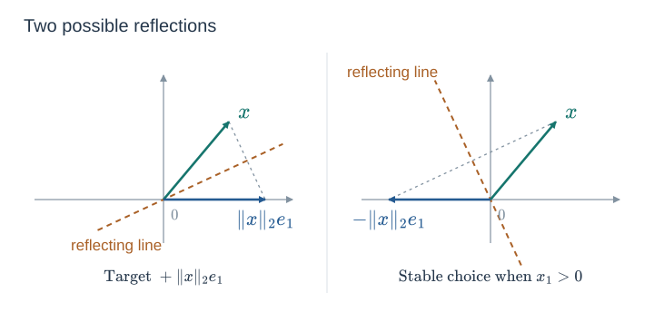
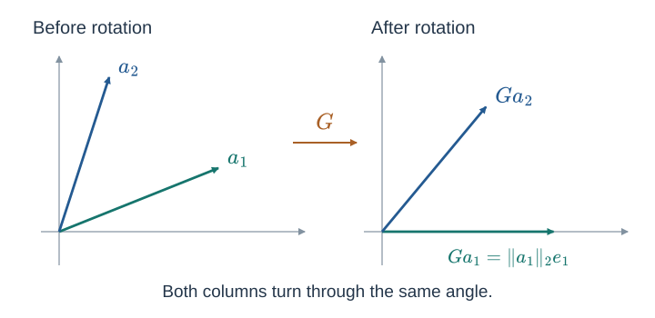

*Numerical Methods I — Florian Schaefer. Source: [Lecture 07.pdf](https://brightspace.nyu.edu/content/enforced/609409-FA26_MATH-GA_2010_1_001_crse/Lecture%2007.pdf), pp. 1–8.*

Let $A\in\mathbb K^{m\times n}$ with $m\ge n$, where $\mathbb K=\mathbb R$ or $\mathbb C$. The symbol $*$ denotes conjugate transpose, and $\langle u,v\rangle=u^*v$. The reflection algorithm and Givens rotation formulas below are written for real data.

## 7.1 Review of Householder Triangularization

<!-- Source: Lecture 07.pdf, pp. 1–2. -->

### 7.1.1 Gram–Schmidt as a Matrix Product

At step $k$ of Gram–Schmidt, the first $k-1$ columns have already become $q_1,\ldots,q_{k-1}$. Write the remaining columns as

$$
x=a_k^{(k-1)},\qquad
C=\begin{pmatrix}a_{k+1}^{(k-1)}&\cdots&a_n^{(k-1)}\end{pmatrix}.
$$

For $\rho=\|x\|_2>0$ and $q_k=x/\rho$, normalization and projection subtraction can be combined into right multiplication by an upper triangular matrix:

$$
\begin{aligned}
&\begin{pmatrix}q_1&\cdots&q_{k-1}&x&C\end{pmatrix}S_k\\
&\qquad=\begin{pmatrix}q_1&\cdots&q_{k-1}&q_k&C-q_kq_k^*C\end{pmatrix},
\end{aligned}
$$

where

$$
S_k=
\begin{pmatrix}
I_{k-1}&0&0\\
0&\rho^{-1}&-\rho^{-1}q_k^*C\\
0&0&I_{n-k}
\end{pmatrix}.
$$

Thus Gram–Schmidt uses triangular transformations on the **right** to produce orthonormal columns. Householder QR instead uses orthogonal transformations on the **left** to produce an upper triangular matrix.

### 7.1.2 Error Amplification in Matrix Products

The stability motivation is the backward error in multiplying by an invertible matrix $X$. If

$$
\begin{gathered}
\operatorname{fl}(XA)=XA+E=X(A+F),\\
F=X^{-1}E,
\end{gathered}
$$

then the first-order relative bound has the form

$$
\frac{\|F\|_2}{\|A\|_2}
\lesssim u\,\kappa_2(X),
$$

where $u$ is unit roundoff and dimension-dependent constants are suppressed. Orthogonal or unitary $X$ has $\kappa_2(X)=1$, which motivates eliminating entries with such transformations.

### 7.1.3 A Reflection Clears a Column

A Householder reflector has the form

$$
H=I-2\frac{vv^*}{v^*v},
\qquad v\ne0.
$$

It satisfies $H^*=H$ and $H^*H=I$. Choosing $v$ appropriately maps the first column to a multiple of $e_1$:

$$
\begin{pmatrix}
\times&\times&\times\\
\times&\times&\times\\
\times&\times&\times\\
\times&\times&\times\\
\times&\times&\times
\end{pmatrix}
\xrightarrow{\ H_1\ }
\begin{pmatrix}
\times&\times&\times\\
0&\times&\times\\
0&\times&\times\\
0&\times&\times\\
0&\times&\times
\end{pmatrix}.
$$

Here $\times$ denotes an entry that need not be zero.

For real nonzero $x$, either $\|x\|_2e_1$ or $-\|x\|_2e_1$ is a possible reflected vector. Choose the target with sign opposite to $x_1$:

$$
\begin{aligned}
\sigma&=\operatorname{sign}(x_1),\\
v&=x+\sigma\|x\|_2e_1,\\
Hx&=-\sigma\|x\|_2e_1,
\end{aligned}
$$

using $\operatorname{sign}(0)=1$. This choice avoids cancellation in the first component of $v$.



The reflector is unchanged when $v$ is multiplied by a nonzero scalar. We therefore normalize it so that $v_1=1$.

### 7.1.4 The Later Steps Preserve Earlier Zeros

After eliminating the first $k-1$ column tails, the next reflection acts only on rows $k,\ldots,m$:

$$
H_k=
\begin{pmatrix}
I_{k-1}&0\\
0&F_k
\end{pmatrix},
\qquad
F_k=I-2\frac{v_kv_k^*}{v_k^*v_k}.
$$

The first $k-1$ rows are unchanged. In earlier columns, the active row segments are already zero, and multiplying those zero segments by $F_k$ preserves them. Thus each step creates new zeros without undoing the previous eliminations.

### 7.1.5 In-Place Householder QR

For real $A$ of full column rank, every active vector $x=A[k:m,k]$ is nonzero. The complete algorithm is:

```text
Input: A, an m × n real matrix of full column rank, m ≥ n

for k = 1,...,n:
    x = copy of A[k:m, k]
    sigma = sign(x[1]), with sign(0) = 1
    v = x + sigma * norm(x) * e1
    v = v / v[1]

    A[k:m, k:n] = A[k:m, k:n]
                 - 2 * v * (v* A[k:m, k:n]) / (v* v)

    A[k+1:m, k] = v[2:end]

Return A
```

In the pseudocode, `v*` denotes the transpose or adjoint, while a separate `*` between factors denotes multiplication. The leading entry of every stored $v$ is implicitly 1. Its tail occupies the entries below the diagonal; the diagonal and upper triangle contain the triangular factor.

For example, when $m=5$ and $n=3$, the stored array has the pattern

$$
\begin{pmatrix}
r_{11}&r_{12}&r_{13}\\
(v_1)_2&r_{22}&r_{23}\\
(v_1)_3&(v_2)_2&r_{33}\\
(v_1)_4&(v_2)_3&(v_3)_2\\
(v_1)_5&(v_2)_4&(v_3)_3
\end{pmatrix}.
$$

The subdiagonal entries are storage for the reflectors; the corresponding entries of $R_{\mathrm{full}}$ are zero. As a factorization,

$$
\begin{gathered}
H_n\cdots H_1A=R_{\mathrm{full}},\\
A=Q_{\mathrm{full}}R_{\mathrm{full}},\qquad
Q_{\mathrm{full}}=H_1\cdots H_n.
\end{gathered}
$$

## 7.2 Using Q without Forming It

<!-- Source: Lecture 07.pdf, p. 3. -->

For one active vector segment $z$,

$$
F_kz=z-2v_k\frac{v_k^*z}{v_k^*v_k}.
$$

Only an inner product and a scaled vector subtraction are required. We do not need to form $F_k$ as a dense matrix.

### 7.2.1 Applying the Adjoint

Since each reflector is self-adjoint,

$$
Q_{\mathrm{full}}^*=H_n\cdots H_1.
$$

The rightmost factor acts first, so $Q_{\mathrm{full}}^*b$ is computed in **forward construction order**:

```text
Input: b in K^m and the stored Householder vectors

for k = 1,...,n:
    v = [1; A[k+1:m, k]]
    b[k:m] = b[k:m] - 2 * v * (v* b[k:m]) / (v* v)

Return b                 # now Q_full* b
```

### 7.2.2 Applying Q

For $Q_{\mathrm{full}}b=H_1\cdots H_nb$, the factor $H_n$ acts first. Use **reverse construction order**:

```text
Input: b in K^m and the stored Householder vectors

for k = n,n-1,...,1:
    v = [1; A[k+1:m, k]]
    b[k:m] = b[k:m] - 2 * v * (v* b[k:m]) / (v* v)

Return b                 # now Q_full b
```

For instance, when $Q=H_1H_2$, computing $Qb$ means applying $H_2$ and then $H_1$; computing $Q^*b$ means applying $H_1$ and then $H_2$.

### 7.2.3 What the Stored Vectors Represent

The construction gives three properties:

- **In-place storage:** each reflector has an implicit leading 1, and its tail fits below the diagonal of the original array.
- **Full QR:** the stored transformations act on all of $\mathbb K^m$, even though there are only $n$ reflector vectors.
- **Orthogonality by construction:** the exact matrix defined by those vectors is a product of orthogonal or unitary matrices.

## 7.3 Givens Rotations

<!-- Source: Lecture 07.pdf, pp. 4–5. -->

If a matrix is almost upper triangular, clearing an entire column tail may be unnecessary. A Givens rotation acts on just two rows and can eliminate a single entry.

### 7.3.1 The Two-Dimensional Rotation

For real $a,b$ with $r=\sqrt{a^2+b^2}>0$, set

$$
c=\frac ar,\qquad s=\frac br,\qquad
G=\begin{pmatrix}c&s\\-s&c\end{pmatrix}.
$$

Since $c^2+s^2=1$, $G^TG=I$. Its action on the vector is

$$
\begin{aligned}
G\begin{pmatrix}a\\b\end{pmatrix}
&=\begin{pmatrix}ca+sb\\-sa+cb\end{pmatrix}\\
&=\begin{pmatrix}(a^2+b^2)/r\\(-ba+ab)/r\end{pmatrix}\\
&=\begin{pmatrix}r\\0\end{pmatrix}.
\end{aligned}
$$

For a two-row matrix, take $a=A_{11}$ and $b=A_{21}$. The first column rotates onto the first coordinate axis, and the same rotation acts on every other column.



### 7.3.2 Embedding the Rotation in a Larger Matrix

To eliminate $A_{ji}$ using $A_{ii}$, with $j>i$, choose

$$
r=\sqrt{A_{ii}^2+A_{ji}^2},\qquad
c=\frac{A_{ii}}r,\qquad
s=\frac{A_{ji}}r.
$$

Embed the $2\times2$ rotation into rows and columns $i,j$ of an identity matrix. Its only nontrivial entries are

$$
G_{ii}=G_{jj}=c,\qquad G_{ij}=s,\qquad G_{ji}=-s.
$$

Left multiplication changes only those two rows:

$$
\begin{aligned}
\text{new row }i&=c\,\text{old row }i+s\,\text{old row }j,\\
\text{new row }j&=-s\,\text{old row }i+c\,\text{old row }j.
\end{aligned}
$$

Both formulas use the old rows. In column $i$, they give the pair $(r,0)^T$. If both original entries are zero, use the identity transformation.

For example, a rotation on rows 2 and 4 produces the pattern

$$
\begin{pmatrix}
\times&\times&\times&\times\\
0&\times&\times&\times\\
0&\times&\times&\times\\
0&\times&\times&\times\\
0&0&\times&\times
\end{pmatrix}
\xrightarrow{\ G_{(2,4)}\ }
\begin{pmatrix}
\times&\times&\times&\times\\
0&\times&\times&\times\\
0&\times&\times&\times\\
0&0&\times&\times\\
0&0&\times&\times
\end{pmatrix}.
$$

Repeat until the matrix is upper triangular, retaining the rotations to represent $Q$. Givens rotations are less efficient than Householder transformations for dense matrices, but can be more efficient for some sparse matrices.

## 7.4 Full and Reduced QR

<!-- Source: Lecture 07.pdf, p. 6. -->

### 7.4.1 Reduced QR

A **reduced QR factorization** has the dimensions

$$
\underbrace{A}_{m\times n}
=
\underbrace{Q}_{m\times n}
\underbrace{R}_{n\times n},
\qquad Q^*Q=I_n,
$$

where $R$ is upper triangular. The columns of $Q$ are orthonormal. Gram–Schmidt directly constructs this form.

### 7.4.2 Full QR

A **full QR factorization** has the dimensions

$$
\underbrace{A}_{m\times n}
=
\underbrace{Q_{\mathrm{full}}}_{m\times m}
\underbrace{R_{\mathrm{full}}}_{m\times n},
\qquad
Q_{\mathrm{full}}^*Q_{\mathrm{full}}=I_m.
$$

Writing the factors in blocks makes the relationship clear:

$$
A=
\underbrace{\begin{pmatrix}Q&Q_\perp\end{pmatrix}}_{Q_{\mathrm{full}}}
\underbrace{\begin{pmatrix}R\\0\end{pmatrix}}_{R_{\mathrm{full}}}
=QR.
$$

Here $Q_\perp$ has $m-n$ columns and completes the orthonormal basis. Householder and Givens transformations naturally represent the full orthogonal or unitary matrix implicitly. Taking its first $n$ columns gives the reduced factorization.

## 7.5 Existence of QR

<!-- Source: Lecture 07.pdf, p. 7. -->

> [!theorem] Existence
> Every $A\in\mathbb K^{m\times n}$ with $m\ge n$ has both a reduced and a full QR factorization.

### 7.5.1 Full Column Rank

Use Gram–Schmidt. At step $k$, form the unnormalized residual

$$
\widehat q_k
=a_k-\sum_{j=1}^{k-1}q_j\langle q_j,a_k\rangle.
$$

If $\widehat q_k=0$, then

$$
\begin{aligned}
a_k\in\operatorname{span}(q_1,\ldots,q_{k-1})
&=\operatorname{span}(a_1,\ldots,a_{k-1}).
\end{aligned}
$$

This contradicts full column rank. Therefore every $\widehat q_k$ is nonzero and can be normalized:

$$
r_{kk}=\|\widehat q_k\|_2>0,
\qquad q_k=\frac{\widehat q_k}{r_{kk}}.
$$

The resulting $Q$ has orthonormal columns, and the projection coefficients give the upper triangular $R$.

### 7.5.2 Rank-Deficient Matrices

Follow the same construction. Whenever $\widehat q_k=0$, choose any **unit vector** $q_k$ orthogonal to $q_1,\ldots,q_{k-1}$ and set $r_{kk}=0$.

Such a vector exists because $k-1<m$. The current column is still represented correctly:

$$
a_k=\sum_{j=1}^{k-1}q_jr_{jk}+q_k\,0.
$$

Continue Gram–Schmidt with this enlarged orthonormal family. This gives a reduced QR factorization even when $A$ is rank deficient.

### 7.5.3 Completing to Full QR

After constructing $q_1,\ldots,q_n$, add $m-n$ orthonormal vectors to complete a basis of $\mathbb K^m$. Then

$$
\begin{gathered}
Q_{\mathrm{full}}=
\begin{pmatrix}q_1&\cdots&q_n&q_{n+1}&\cdots&q_m\end{pmatrix},\\
R_{\mathrm{full}}=\begin{pmatrix}R\\0\end{pmatrix}
\end{gathered}
$$

gives $A=Q_{\mathrm{full}}R_{\mathrm{full}}$.

## 7.6 Uniqueness of QR

<!-- Source: Lecture 07.pdf, p. 8. -->

Full QR is not unique when $m>n$: the added orthonormal basis vectors can be chosen in different ways. Reduced QR is also not generally unique for a rank-deficient matrix, because a zero residual leaves a choice of $q_k$.

> [!theorem] Uniqueness of reduced QR
> If $A\in\mathbb K^{m\times n}$, $m\ge n$, has full column rank, then its reduced QR factorization is unique when the diagonal entries of $R$ are required to be positive real numbers.

### 7.6.1 The kth Column Is Determined up to a Scalar

Suppose

$$
A=QR=\widetilde Q\widetilde R
$$

are two reduced factorizations. For each $k$, both $q_k$ and $\widetilde q_k$ belong to

$$
S_k=\operatorname{span}(a_1,\ldots,a_k)
$$

and are orthogonal to

$$
S_{k-1}=\operatorname{span}(a_1,\ldots,a_{k-1}).
$$

Because $S_k$ is spanned by $q_k$ together with $S_{k-1}$, write

$$
\widetilde q_k
=\alpha q_k+\sum_{j=1}^{k-1}\gamma_j a_j.
$$

Orthogonality to all the earlier columns gives

$$
\langle q_k,\widetilde q_k\rangle
=\langle q_k,\alpha q_k\rangle=\alpha
$$

and

$$
\langle\widetilde q_k,\widetilde q_k\rangle
=\langle\widetilde q_k,\alpha q_k\rangle.
$$

Since both vectors have norm 1,

$$
1
=\langle\widetilde q_k,\alpha q_k\rangle
=\alpha\,\overline{\langle q_k,\widetilde q_k\rangle}
=|\alpha|^2.
$$

Now expand the squared difference, as in the lecture:

$$
\begin{aligned}
\|\widetilde q_k-\alpha q_k\|_2^2
&=\langle\widetilde q_k,\widetilde q_k\rangle
  -\langle\widetilde q_k,\alpha q_k\rangle\\
&\quad-\langle\alpha q_k,\widetilde q_k\rangle
  +\langle\alpha q_k,\alpha q_k\rangle\\
&=1-1-1+1\\
&=0.
\end{aligned}
$$

Therefore $\widetilde q_k=\alpha q_k$, with $|\alpha|=1$.

### 7.6.2 Positive Diagonal Entries Remove the Ambiguity

The diagonal coefficient is $r_{kk}=\langle q_k,a_k\rangle$, so

$$
\widetilde r_{kk}
=\langle\widetilde q_k,a_k\rangle
=\overline\alpha\,r_{kk}.
$$

Both $r_{kk}$ and $\widetilde r_{kk}$ are positive real numbers. Together with $|\alpha|=1$, this forces $\alpha=1$. Hence $\widetilde q_k=q_k$ for every $k$, and therefore $\widetilde Q=Q$.

Finally,

$$
R=Q^*A=\widetilde Q^*A=\widetilde R.
$$

This proves uniqueness with the stated normalization.

## 7.7 Corrections to the Handwritten Notes

1. **Scaling of the backward-error bound (p. 1).** An absolute bound for $\|F\|_2$ needs the scale factor $\|A\|_2$. The recap above states the relative form $\|F\|_2/\|A\|_2\lesssim u\kappa_2(X)$, with dimension-dependent constants and higher-order terms suppressed.

2. **Householder sign and storage (p. 2).** Define $\operatorname{sign}(0)=1$ in the real construction. After normalizing $v_1=1$, the assignment below the diagonal must store only $v[2:\mathrm{end}]$, not all of $v$: the handwritten assignment has incompatible lengths. The displayed algorithm assumes full column rank; if an active column segment is zero, it requires no reflection and that step must be skipped when applying the factors.

3. **Orthogonality of the implicit factor (p. 3).** The product mathematically defined by the stored reflectors is orthogonal or unitary. Applying it or explicitly forming it in floating-point arithmetic still incurs rounding error.

4. **Normalization in the existence proof (p. 7).** When a Gram–Schmidt residual vanishes, the replacement vector must be a **unit** vector orthogonal to the previously chosen columns. Orthogonality alone does not ensure $Q^*Q=I$.

5. **The missing uniqueness condition (p. 8).** Full column rank alone does not make reduced QR unique. A sign can be moved between a column of $Q$ and a row of $R$ over $\mathbb R$; a unit-modulus phase can be moved over $\mathbb C$. Requiring the diagonal of $R$ to be positive real removes this ambiguity. The inner-product argument above follows the lecture and includes this final normalization step.
