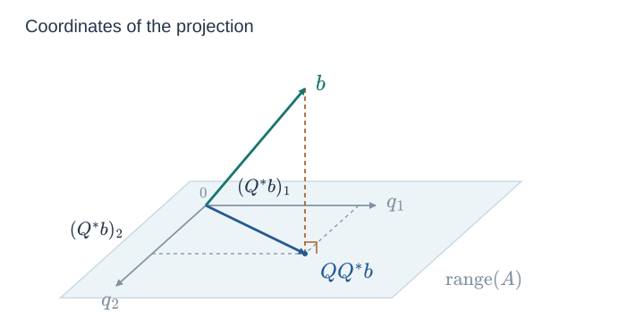
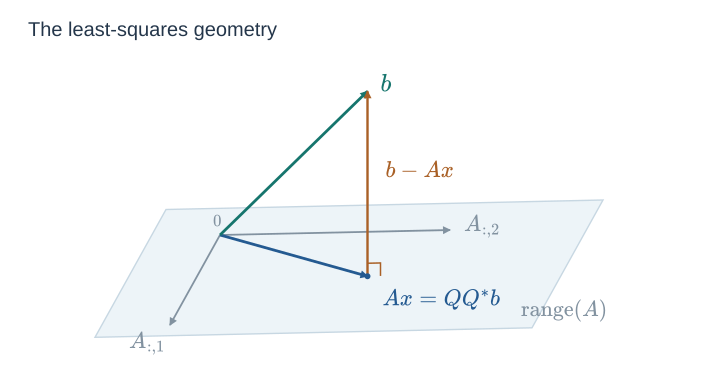

*Numerical Methods I — Florian Schaefer. Source: [Lecture 08.pdf](https://brightspace.nyu.edu/content/enforced/609409-FA26_MATH-GA_2010_1_001_crse/Lecture%2008.pdf), pp. 1–9.*

Throughout, $\mathbb K$ is $\mathbb R$ or $\mathbb C$, $*$ denotes conjugate transpose, and $\langle u,v\rangle=u^*v$.

## 8.1 Recap: Orthogonal Transformations and QR

<!-- Source: Lecture 08.pdf, p. 1. -->

[[7. Orthogonal Transformations and QR|Lecture 7]] constructed QR using Householder reflections and Givens rotations, then discussed full and reduced QR and their existence and uniqueness.

If

$$
\begin{gathered}
Q=H_1\cdots H_n,\qquad
H_k=\begin{pmatrix}I_{k-1}&0\\0&F_k\end{pmatrix},\\
F_k=I-2\frac{v_kv_k^*}{v_k^*v_k},
\end{gathered}
$$

we can apply $Q$ or $Q^*$ using the stored vectors alone. Each step updates the active part of a vector:

$$
b_{k:m}\leftarrow b_{k:m}
-2v_k\frac{v_k^*b_{k:m}}{v_k^*v_k}.
$$

For $Q^*b$, use $k=1,\ldots,n$; for $Qb$, use $k=n,\ldots,1$. The order follows from $Q^*=H_n\cdots H_1$, with the rightmost factor acting first.

A real Givens rotation acts on just two coordinates:

$$
\begin{gathered}
\begin{pmatrix}c&s\\-s&c\end{pmatrix}
\begin{pmatrix}a\\b\end{pmatrix}
=
\begin{pmatrix}\sqrt{a^2+b^2}\\0\end{pmatrix},\\[4pt]
c=\frac{a}{\sqrt{a^2+b^2}},\qquad
s=\frac{b}{\sqrt{a^2+b^2}}.
\end{gathered}
$$

Here $(a,b)\ne(0,0)$; an already zero pair needs no rotation. Repeated orthogonal transformations give a full QR factorization. Its first $n$ columns give the reduced factorization.

## 8.2 The Overdetermined Least-Squares Problem

<!-- Source: Lecture 08.pdf, p. 2. -->

Let $A\in\mathbb K^{m\times n}$ with $m\ge n$, and let $b\in\mathbb K^m$. We seek

$$
\min_{x\in\mathbb K^n}\|Ax-b\|_2^2.
$$

Suppose $A$ has full column rank and write its reduced QR factorization as

$$
A=QR,
\qquad Q^*Q=I_n,
\qquad R\in\mathbb K^{n\times n}.
$$

The proposed solution is

$$
\boxed{Rx=Q^*b,\qquad x=R^{-1}Q^*b.}
$$

Computationally, we apply $Q^*$ and solve the upper triangular system. Geometrically, the columns of $Q$ give orthonormal coordinates in the column space of $A$: $Q^*b$ gives the coordinates of the projection, and $QQ^*b$ is the projected vector itself.

To justify this construction, we first characterize a least-squares minimizer.

## 8.3 Optimality: The Residual Must Be Orthogonal

<!-- Source: Lecture 08.pdf, p. 3. -->

If $x$ minimizes the squared residual, every perturbation $\varepsilon\in\mathbb K^n$ satisfies

$$
\|A(x+\varepsilon)-b\|_2^2
\ge \|Ax-b\|_2^2.
$$

Write $r=Ax-b$. Expanding the difference gives

$$
\begin{aligned}
0
&\le \|A\varepsilon+r\|_2^2-\|r\|_2^2\\
&=\langle A\varepsilon+r,A\varepsilon+r\rangle
  -\langle r,r\rangle\\
&=\langle A\varepsilon,A\varepsilon\rangle
  +\langle A\varepsilon,r\rangle
  +\langle r,A\varepsilon\rangle\\
&=\|A\varepsilon\|_2^2
  +2\operatorname{Re}\langle A\varepsilon,r\rangle.
\end{aligned}
$$

Fix an arbitrary direction $\bar\varepsilon\in\mathbb K^n$ and set $\varepsilon=\delta\bar\varepsilon$, where $\delta\in\mathbb R$. Then, for every real $\delta$,

$$
0\le
\delta^2\|A\bar\varepsilon\|_2^2
+2\delta\operatorname{Re}\langle A\bar\varepsilon,r\rangle.
$$

For $\delta>0$, divide by $\delta$ and let $\delta\to0^+$:

$$
\begin{gathered}
0\le \delta\|A\bar\varepsilon\|_2^2
+2\operatorname{Re}\langle A\bar\varepsilon,r\rangle\\
\Longrightarrow\quad
0\le\operatorname{Re}\langle A\bar\varepsilon,r\rangle.
\end{gathered}
$$

For $\delta<0$, division reverses the inequality. Letting $\delta\to0^-$ gives

$$
\begin{gathered}
0\ge \delta\|A\bar\varepsilon\|_2^2
+2\operatorname{Re}\langle A\bar\varepsilon,r\rangle\\
\Longrightarrow\quad
0\ge\operatorname{Re}\langle A\bar\varepsilon,r\rangle.
\end{gathered}
$$

Consequently,

$$
\operatorname{Re}\langle A\bar\varepsilon,r\rangle=0
\qquad\text{for every }\bar\varepsilon.
$$

Over $\mathbb R$, this is already the desired orthogonality. Over $\mathbb C$, use the direction $i\bar\varepsilon$ as well. Since the first argument of the inner product is conjugate-linear,

$$
\langle A(i\bar\varepsilon),r\rangle
=-i\langle A\bar\varepsilon,r\rangle.
$$

Its real part is the imaginary part of $\langle A\bar\varepsilon,r\rangle$, so that imaginary part must also vanish.

> [!theorem] Least-squares optimality condition
> A vector $x$ minimizes $\|Ax-b\|_2^2$ if and only if
> $$
> \langle A\bar\varepsilon,Ax-b\rangle=0
> \qquad\text{for every }\bar\varepsilon\in\mathbb K^n.
> $$
> Equivalently, $Ax-b$ is orthogonal to the column space of $A$.

The calculation above proves necessity. For the converse, if the cross terms vanish, then for any $\varepsilon$,

$$
\|A(x+\varepsilon)-b\|_2^2-\|Ax-b\|_2^2
=\|A\varepsilon\|_2^2\ge0.
$$

The same condition can be written as

$$
\boxed{
\langle A\bar\varepsilon,Ax\rangle
=\langle A\bar\varepsilon,b\rangle
\quad\text{for all }\bar\varepsilon.
}
$$

## 8.4 Why the QR Solution Works

<!-- Source: Lecture 08.pdf, p. 4. -->

### 8.4.1 Square and Rectangular Systems

If $A$ is square and nonsingular, choose

$$
\bar\varepsilon=A^{-1}(Ax-b).
$$

The optimality condition then implies

$$
\begin{aligned}
0&=\langle A\bar\varepsilon,Ax-b\rangle\\
&=\langle Ax-b,Ax-b\rangle\\
&=\|Ax-b\|_2^2.
\end{aligned}
$$

Thus $Ax=b$. In this case, every vector in the ambient space is available as $A\bar\varepsilon$.

For tall or singular $A$, the vectors $A\bar\varepsilon$ range only over the column space of $A$. A residual can be nonzero while remaining orthogonal to that space.

### 8.4.2 Substitution of the QR Formula

For full-column-rank $A=QR$, let $x=R^{-1}Q^*b$. For every $\bar\varepsilon$,

$$
\begin{aligned}
\langle A\bar\varepsilon,Ax-b\rangle
&=\langle QR\bar\varepsilon,
          QR R^{-1}Q^*b-b\rangle\\
&=\langle QR\bar\varepsilon,QQ^*b-b\rangle\\
&=\langle R\bar\varepsilon,Q^*(QQ^*b-b)\rangle\\
&=\langle R\bar\varepsilon,Q^*Q Q^*b-Q^*b\rangle\\
&=\langle R\bar\varepsilon,Q^*b-Q^*b\rangle\\
&=0.
\end{aligned}
$$

This satisfies the optimality condition. Hence solving $Rx=Q^*b$ gives a least-squares minimizer. Full column rank makes it unique: in the difference formula above, $\|A\varepsilon\|_2^2>0$ whenever $\varepsilon\ne0$.

## 8.5 The Normal Equations

<!-- Source: Lecture 08.pdf, p. 5. -->

We can also obtain a square system directly from the optimality condition. Move $A$ to the other side of the inner product:

$$
\begin{aligned}
\langle A\bar\varepsilon,Ax\rangle
&=\langle A\bar\varepsilon,b\rangle
&&\text{for every }\bar\varepsilon,\\
\langle\bar\varepsilon,A^*Ax\rangle
&=\langle\bar\varepsilon,A^*b\rangle
&&\text{for every }\bar\varepsilon.
\end{aligned}
$$

A vector orthogonal to every $\bar\varepsilon\in\mathbb K^n$ must be zero. Therefore

$$
\boxed{A^*Ax=A^*b.}
$$

These are the **normal equations**. Their coefficient matrix has two useful properties:

- $A^*A$ is $n\times n$, even when $A$ is rectangular.
- $(A^*A)^*=A^*A$, so it is Hermitian, or symmetric over $\mathbb R$.

The drawback is the squared condition number. For full-column-rank $A$, in the Euclidean norm,

$$
\kappa_2(A^*A)=\kappa_2(A)^2.
$$

Thus passing to the normal equations can amplify sensitivity and lead to a loss of accuracy. The structure of $A^*A$ motivates the next part of the lecture.

## 8.6 Hermitian Matrices and Positivity

<!-- Source: Lecture 08.pdf, p. 6. -->

### 8.6.1 Symmetry and Eigenvalues

> [!definition] Hermitian and skew-Hermitian matrices
> A square matrix is **Hermitian** if $A^*=A$, and **skew-Hermitian** if $A^*=-A$.

For real matrices, these are the symmetric and skew-symmetric cases. Hermitian matrices have real eigenvalues; skew-Hermitian matrices have purely imaginary eigenvalues, with zero allowed.

### 8.6.2 Positive Semidefinite and Positive Definite Matrices

> [!definition] Positivity
> A Hermitian matrix $A$ is **positive semidefinite** if
> $$
> v^*Av\ge0\qquad\text{for every }v.
> $$
> It is **positive definite** if
> $$
> v^*Av>0\qquad\text{for every }v\ne0.
> $$

### 8.6.3 Polar Decomposition

A square complex matrix can be written as

$$
A=US,
$$

where $U$ is unitary and $S$ is Hermitian positive semidefinite. This is the **polar decomposition**: $S$ provides a positive stretching factor, followed by the length-preserving transformation $U$.

## 8.7 Gram Matrices

<!-- Source: Lecture 08.pdf, pp. 7–8 (repeated statement and proof), then p. 9. -->

For a least-squares matrix $B$, the normal equations take the form

$$
B^*Bx=B^*b.
$$

The coefficient matrix $B^*B$ is called a **Gram matrix**, or **inner-product matrix**. Its entries are the inner products of the columns of $B$:

$$
\begin{aligned}
(B^*B)_{ij}
&=\langle e_i,B^*Be_j\rangle\\
&=\langle Be_i,Be_j\rangle\\
&=\langle B_{:,i},B_{:,j}\rangle.
\end{aligned}
$$

> [!theorem] Gram matrices and positivity
> 1. A square matrix $A$ is Hermitian positive semidefinite if and only if $A=B^*B$ for some matrix $B$.
> 2. The Gram matrix $B^*B$ is positive definite if and only if $B$ has full column rank.

### 8.7.1 A Gram Matrix Is Hermitian Positive Semidefinite

If $A=B^*B$, then

$$
A^*=(B^*B)^*=B^*(B^*)^*=B^*B=A.
$$

Also, for every $x$,

$$
\begin{aligned}
x^*Ax&=x^*B^*Bx=(Bx)^*(Bx)\\
&=\|Bx\|_2^2\ge0.
\end{aligned}
$$

So $A$ is Hermitian and positive semidefinite.

### 8.7.2 A Hermitian Positive Semidefinite Matrix Is a Gram Matrix

Let $A$ be Hermitian positive semidefinite. Its eigendecomposition is

$$
\begin{gathered}
A=U^*\Lambda U,\qquad UU^*=U^*U=I,\\
\Lambda=\operatorname{diag}(\lambda_1,\ldots,\lambda_n).
\end{gathered}
$$

Hermitian symmetry makes the eigenvalues real. Positivity makes them nonnegative: for an eigenvector $z_i\ne0$,

$$
0\le z_i^*Az_i
=\lambda_i\|z_i\|_2^2
\quad\Longrightarrow\quad\lambda_i\ge0.
$$

We can therefore form

$$
\sqrt\Lambda
=\operatorname{diag}(\sqrt{\lambda_1},\ldots,\sqrt{\lambda_n}).
$$

Insert $UU^*=I$ between the two square-root factors:

$$
\begin{aligned}
A
&=U^*\Lambda U\\
&=U^*\sqrt\Lambda\,\sqrt\Lambda U\\
&=U^*\sqrt\Lambda\,(UU^*)\sqrt\Lambda U\\
&=(U^*\sqrt\Lambda U)(U^*\sqrt\Lambda U).
\end{aligned}
$$

Set $C=U^*\sqrt\Lambda U$. Since $\sqrt\Lambda$ is real diagonal,

$$
C^*=(U^*\sqrt\Lambda U)^*
=U^*\sqrt\Lambda U=C.
$$

Hence the factorization above is

$$
\boxed{A=C^*C,\qquad C=U^*\sqrt\Lambda U.}
$$

This proves that $A$ is a Gram matrix.

### 8.7.3 Positive Definiteness and Full Column Rank

<!-- Source: Lecture 08.pdf, p. 9. -->

A matrix $B$ fails to have full column rank exactly when it has a nonzero null vector. Using the identity from the first part,

$$
\begin{gathered}
B\text{ is column-rank deficient}\\
\iff \exists x\ne0:\ Bx=0\\
\iff \exists x\ne0:\ \|Bx\|_2^2=0\\
\iff \exists x\ne0:\ x^*B^*Bx=0.
\end{gathered}
$$

Since $B^*B$ is already positive semidefinite, this is precisely the failure of positive definiteness. Thus

$$
\boxed{\begin{gathered}
B^*B\text{ is positive definite}\\
\iff B\text{ has full column rank}.
\end{gathered}}
$$

## 8.8 Corrections to the Handwritten Notes

1. **Cross-term signs (p. 3).** With $r=Ax-b$, expanding $\langle A\varepsilon+r,A\varepsilon+r\rangle$ gives two **plus** cross terms. The handwritten intermediate signs are inconsistent. The expansion and subsequent inequalities above use the corrected signs.

2. **The complex case in the optimality argument (p. 3).** Real scaling first proves that the real part of $\langle A\bar\varepsilon,r\rangle$ vanishes. To conclude that the full inner product is zero over $\mathbb C$, one must also use the direction $i\bar\varepsilon$. That missing step is included above.

3. **Meaning of “positive” (p. 6).** The non-strict inequality $v^*Av\ge0$ defines positive **semidefiniteness**. Positive definiteness requires strict inequality for every nonzero $v$. The two terms are distinguished consistently above; zero eigenvalues are allowed in the semidefinite case.

4. **Gram-matrix dimensions and names (pp. 7–8).** A Hermitian matrix is square. In the rank statement, the relevant condition is that the factor $B$ has full column rank: $B^*B$ is positive definite if and only if $B$ has full column rank. The handwritten statement switches matrix names.

5. **The squared norm (pp. 7–8).** The correct identity is $x^*B^*Bx=\|Bx\|_2^2$, with a square on the norm.
